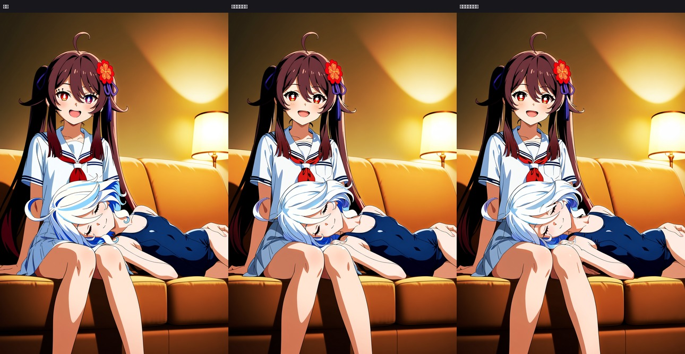

[English](README.md) | **中文说明**

# comfyui-agent-suite

让 agent 学会"**用 ComfyUI 出图 / 局部重绘 / 与人协作**"的一套工具。核心是 `skill/`（agent 读的说明书 + 脚本），
`libs/` 下是若干**可独立成库**的组件 —— 按需装，不强迫你复制作者的环境。

- **不含数据集、不含任何原图**；模型权重走 Release 下载。
- **`skill/` 本体几乎没有依赖**：驱动脚本是 Node（只用内置模块），Python 侧只要 `Pillow` + `numpy`。
- 需要"检测/抠图/闸门"这些重活时，再装对应的 `libs/*`（各自声明自己的依赖）。

## 模块成熟度（**先看这张表再用**）

有些模块是打磨过的，有些还在开发中 —— 说清楚，免得你按"全都可靠"来用：

| 模块 | 状态 | 说明 |
|---|---|---|
| **检测（M2a 人/手/脚/头、M2b 面部四类）** | ✅ **相对可靠** | 按源图切分 + 多种子验证过；头部框尤其准（掩版的"头"就用它的**内接椭圆**） |
| 局部质量分类（M3） | ⚠️ 可用但样本少 | 只对"结构错/糊/缺件"这类粗判可靠；缺陷样本量是瓶颈 |
| **骨架（M1 关键点）** | ✅ **可用**（2026-10-14 起） | 换成在**人工标注**上微调的 ViTPose：固定 15 张报告集（279–297 关节）覆盖 **88%**、中位 **23.1px**、p90 **97.8**；旧的 YOLO-pose 是 89% / 70.5 / 335.0，dwpose 是 52% / 26.2 / 224.0。与 dwpose 配对聚类 bootstrap：中位 −2.0px「无差别」、**均值 −31.8px 显著**；面点从"只报两只眼"变成 5 个全有（鼻 14.1 / 眼 11–13 / 耳 20–23px）。**仍有限制**：背面/侧脸的面点会飘、只剩上半身时膝踝会被外推到画布外、手/脚细点不在这一层。细节与复现命令见 `libs/anime-detection/docs/pose_m1_status.md` |
| **绳子（rope）** | ⚠️ **可用**（低对比/暗场景仍漏） | 交付权重换成 79 张人工标注的 G14 配置：留出集 F1 **0.9277±0.0117**、召回 **0.976**（旧 30 图版 0.848 / 0.838）。**读法**：买到的是工作点平移 —— 漏检段 −60%、误检块 +62%、笔数 ±14%（与旧配置「无差别」），按"宁可略偏大、不要漏阴影段"的偏好选它 |
| 人在回路画布 / 闸门 / 抠图 / 控制图 | ✅ 可用 | 见各 `libs/*/README.md` |

**下一步要做的**（欢迎一起做）：
1. **难关节标注一致性**：中位误差已经落在"人工自己重标同一张图"的噪声里（旧/新真值中位差 16px），
   下一步是统一鼻/眼/耳这些反复漂的关节的标注口径，而不是继续堆数据；
2. 绳子模块：更难的评测集（现在留出集只有 5 张，看不出 1~2 个点的改进）+ 采样/正权侧改动；
3. 头/手/脚的**局部重绘掩版**继续用检测框推（M1 的点已可用，但"嘴"这种 COCO-17 里没有的部位仍要从脸框推）。

## 组件与依赖

| 组件 | 作用 | 依赖 | 许可证 |
|---|---|---|---|
| `skill/` | **核心**：SKILL.md + 参考资料 + ComfyUI 驱动 + 自检/放大/小工具 | Node 18+；Python: `Pillow`,`numpy` | MIT |
| `libs/human-canvas/` | 人在回路画布（+ 可选 Photoshop 通道、Windows 托盘提醒） | Node 18+（DSH 插件形态）；PS 可选 | MIT |
| `libs/wd14-gate/` | 出图安全闸门（WD14 打标 / NSFW 判定 / BLOCK 的人工授权通道） | `onnxruntime`,`numpy`,`Pillow`,`pandas` | MIT（模型另有许可） |
| `libs/sam-matting/` | 抠图 / 掩版合成（SAM 提示式分割） | `torch`,`opencv-python`,`Pillow`,`numpy` | MIT（SAM: Apache-2.0） |
| `libs/blender-controlnet/` | Blender 生成 depth / OpenPose / 手部控制图 | Blender 3.x+（脚本用其自带 Python） | MIT |
| `libs/comic-layout/` | 漫画分格排版与嵌字 | `Pillow` | MIT |
| `libs/anime-detection/` | 二次元人体/部件/面部/质量检测与评估（训练+评测+推理） | `torch`,`ultralytics`,`opencv-python`,`Pillow`,`numpy`（标注 GUI 另需 `PyQt5`） | **AGPL-3.0** |

## 安装

```bash
git clone --recursive https://github.com/42cc-hub/comfyui-agent-suite comfyui_agent_suite
python install.py                 # 把 skill 装到 DSH skills 目录 + 生成 config/paths.json
python install.py --with-models   # 顺便下 SAM 与 WD14 模型（可选）
```

`install.py` 只做四件事：装 skill（`--dest` 可改，默认 `~/.dsh/skills/comfyui-image-generation`）、
生成 `config/paths.json`（子库绝对路径 + ComfyUI 地址）、按需下模型、打印自检命令。
**密钥不进仓库**：`config/keys.example.json` 是模板，复制成 `keys.json` 后填（已在 `.gitignore` 里）。

子库的依赖按需装：

```bash
pip install -r requirements.txt                     # skill 本体（Pillow / numpy）
pip install -r libs/wd14-gate/requirements.txt      # 只装你要用的
pip install -r libs/anime-detection/requirements.txt
```

## 模型权重（Release 下载）

仓库**不带权重**。13 个自训模型共 460 MB（人/手/脚/头检测、面部四类、局部质量分类、COCO17 骨架、
**微调 ViTPose 骨架**、**绳子 mask**），出处、配置、指标与 sha256 都记在 `weights/manifest.json`：

```bash
python skill/scripts/fetch_weights.py --list                    # 先看清单与大小
python skill/scripts/fetch_weights.py --from-release 42cc-hub/comfyui-agent-suite@weights-v2
python skill/scripts/fetch_weights.py --from-dir D:/my_runs     # 自己训练完的人：按权重名找 best.pt
```

落到 `libs/anime-detection/runs/<name>/weights/best.pt`（套件脚本的默认查找路径）；
**目录型权重**（微调 ViTPose 是一整个 HF 目录）落到清单里写的 `dest`（`libs/anime-detection/models/…`），
`--from-dir` 直接指向套件根目录即可。逐个比对 sha256：**校验不一致会明确告警，不静默用错权重**；
拿不到就打印清单退出，让人自己下。

## 第一次跑：安装成功探针

**`skill/examples/hutao_furina_two_girls.md`** —— 给一段提示词，出一张
"胡桃 + 芙宁娜同框、且左右与靠肩方向不许反"的图：Anima 底图 → 人体定位 → 按重叠中点切两份互不重叠掩版 →
逐人掩版重绘 → 自检。**跑通即说明安装正确**，而且这套打法（位置交给掩版、身份交给提示词/ LoRA）本身就是
这套工具的主线思路。



左：Anima 底图（同框了，但姿势/朝向还只是"碰巧对"）；中：按检测框把两人切开、各给一份互不重叠掩版后逐人重绘；
右：成品 —— 芙宁娜（死库水）闭眼侧躺在胡桃（水手服）膝上，胡桃看镜头。全程**没有**"把某一块贴回原图"这种合成。

## 推荐配置（作者本机，只是参考）

Windows + `conda` 两个环境（一个跑检测/训练：`torch`+`ultralytics`+`segment_anything`+`opencv`+`PyQt5`；
一个跑训练的新版 torch），Node 18+，Blender 5.x，ComfyUI 本机 7187 端口。
**最小可用**是另一回事：只要 ComfyUI + Node + `Pillow`/`numpy`，`skill/` 的出图与重绘路线就能跑。

## 许可证与合规

各组件按目录各自许可（见上表与各库 `LICENSE`）：顶层 `LICENSE` 是 **MIT**，覆盖 `skill/` 与标为 MIT 的 `libs/*`；
`libs/anime-detection` 单独是 **AGPL-3.0**。**分发包含它的整体组合时，请遵守其中最严格的那份 —— AGPL-3.0**
（该库依赖 Ultralytics；闭源商用需另行获取 Ultralytics 商业许可）。
本仓库**不包含任何训练数据或原图**；`libs/anime-detection` 的权重在私有数据集上训练，
使用者自行负责其使用场景的合规性。
